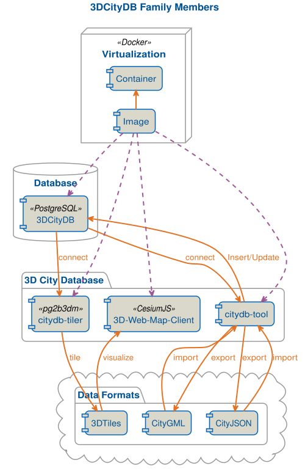
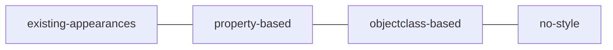
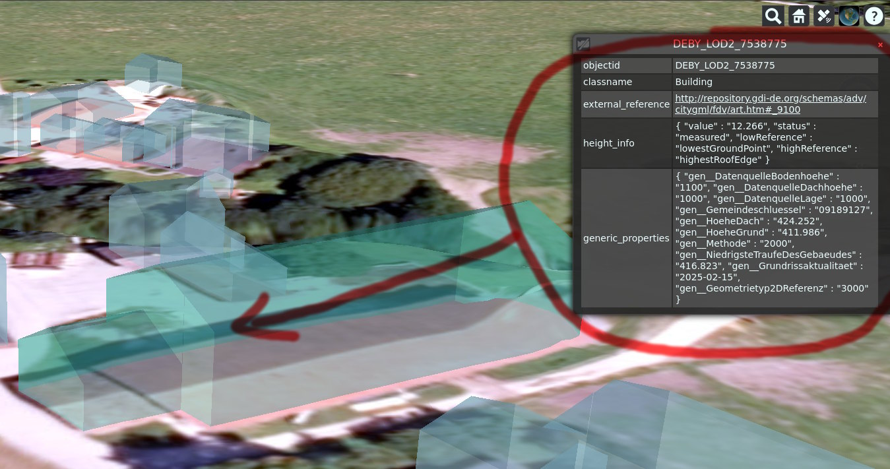

This page explains what happens behind the scenes when you run `citydb-3dtiler`. You do not need to know this to use
the tool, but it helps to understand its behavior and options.

## From database to 3D Tiles

CityGML and 3D Tiles serve different purposes. CityGML describes city objects with rich semantics, while 3D Tiles is
optimized for streaming large amounts of 3D geometry to web viewers. `citydb-3dtiler` bridges the two by combining the
3DCityDB `v5` with the 3D Tiles generator [pg2b3dm](https://github.com/Geodan/pg2b3dm){target="blank"}.

{ width="400" }
/// figure-caption
`citydb-3dtiler` in the 3DCityDB software family.
///

A `tile` run works in three stages:

1. __Prepare the materials__: The materials file is loaded into a helper table in the 3DCityDB schema, and views are
   created that match the materials to object classes and attribute values.
2. __Collect the features__: A query selects the geometries of the features to tile, applies the filters, assigns a
   material to each geometry, and adds the selected attributes. The result is stored in a materialized view.
3. __Generate the tiles__: pg2b3dm reads the materialized view and writes the tileset, including the glTF content of
   the tiles.

Because the work is done inside the database, `citydb-3dtiler` needs permission to create tables and views in the
3DCityDB schema. These objects are recreated on each run.

## Why there is an advise step

A 3D Tiles tileset splits the data into tiles. If a tile contains too much geometry, it loads slowly; if it contains
too little, the viewer has to load many tiles. The `advise` command therefore analyzes the data first: it calculates
the average number of vertices of the geometries and recommends how many features fit into a tile for a target of
about 10,000 vertices. A dataset with detailed LoD3 buildings thus gets fewer features per tile than a dataset with
simple LoD1 blocks.

The `advise` command also records the object classes and attributes in the database, and the coordinate reference
system. The `tile` command uses this information, which is why it runs `advise` automatically if no advice file
exists.

## Styling rules

Each feature gets one material. Where this material comes from is controlled by two options: the style mode and the
behavior if no material is found. The style modes form a hierarchy from specific to generic:

`--style-mode` sets where to start. If no material is found for a feature at this level, `--style-absence-behavior`
decides where to look next:

- `fall-down` (default) moves to the right, towards more generic levels. With `property-based` styling, a feature
  without a matching attribute value gets the color of its object class.
- `rise-up` moves to the left, towards more specific levels. With `objectclass-based` styling, a feature without a
  material for its object class is colored by its attribute values or existing appearances.

With `fall-down`, `citydb-3dtiler` only moves one level: `property-based` falls back to `objectclass-based`, and
`objectclass-based` falls back to the `anything_else` material. Features matching none of these get no material and
are shown in the default color of the viewer. At the `no-style` level, every feature gets the `anything_else`
material.

## Attribute names

3D Tiles stores attributes as simple name-value pairs, while the 3DCityDB stores them as properties with a namespace
and, possibly, nested child properties. `citydb-3dtiler` therefore derives flat attribute names:

| Property in the 3DCityDB                              | Attribute name                              | Example                   |
|-------------------------------------------------------|---------------------------------------------|---------------------------|
| Top-level property                                    | `<namespace>_<name>`                        | `core_name`, `bldg_function` |
| Nested property                                       | `<parent namespace>_<parent name>__<namespace>_<name>` | `con_height__con_value` |

All names are in lower case. The same names are used in the [advice file](reference/advice-file.md), in filters and
with `--selected-attributes`.

With `--attribute-structure flat`, every attribute becomes a separate value in the tiles. With `nested`, complex
properties are kept together as one JSON-like value, as shown below.

/// figure-caption
Nested attributes, e.g. `height_info`, shown in the 3DCityDB-Web-Map-Client.
///

## Current limitations

- Textures are not supported yet. Features are colored with materials only.
- Implicit geometries, e.g. trees defined by a template geometry, are not supported yet.
- Separate tilesets can only be created per object class.
- pg2b3dm is the only supported 3D Tiles generator.
