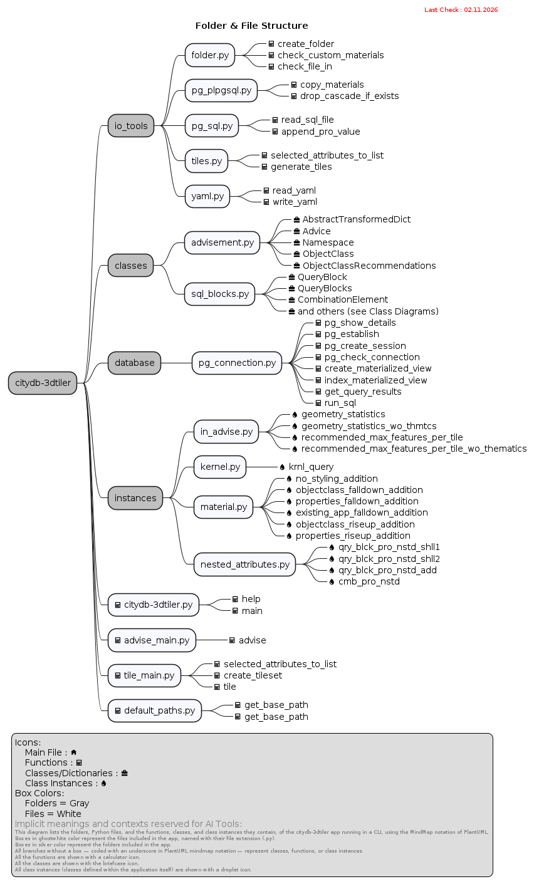

# Folders & Files & Classes / Functions

Following diagram shows which functions/classes are stored in which files & folder.

<!--
```plantuml source="docs/includes/puml/file_structure.puml"
```
-->


