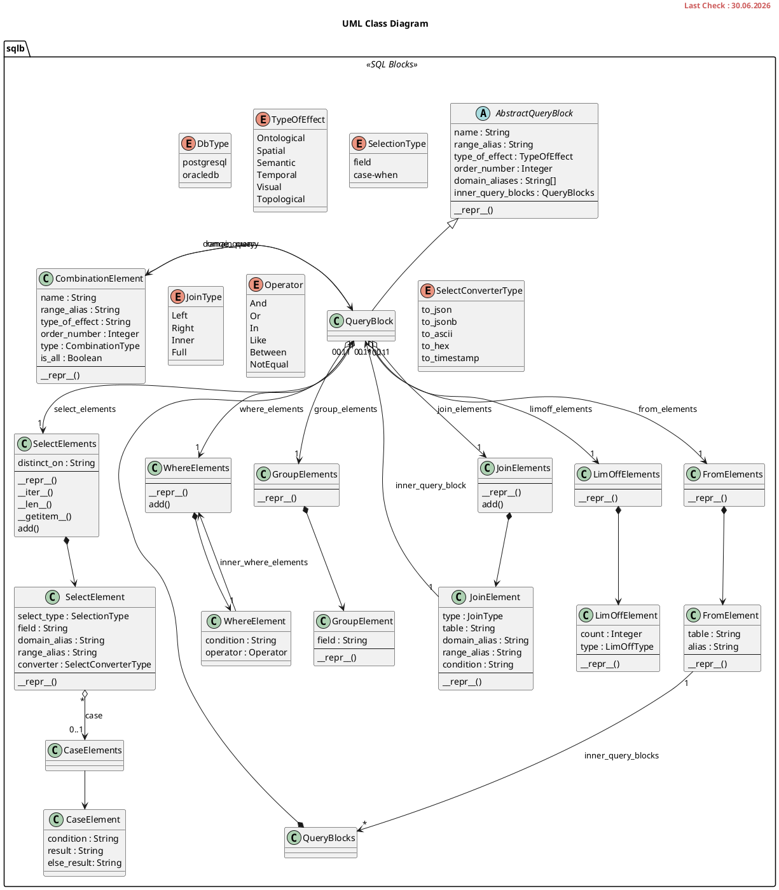

# SQLBlock Classes

This UML diagram shows the classes used to generate the Dynamic (regenerated by the user's commandset) SQL Queries.

<!--
!include https://raw.githubusercontent.com/tum-gis/citydb-3dtiler/main/docs/card-style.puml
-->

<!-- Original File : "sources/plantuml/classes.puml" -->

