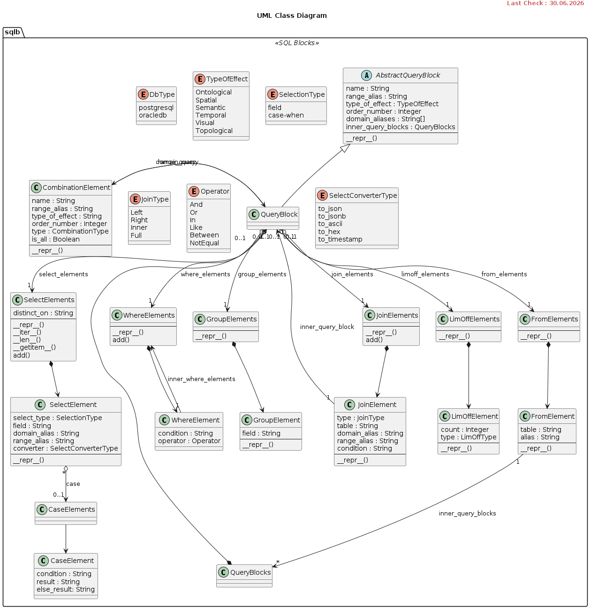

# SQLBlock Classes

This UML diagram shows the classes used to generate the Dynamic (regenerated by the user's commandset) SQL Queries.

<!--
```plantuml source="docs/includes/puml/sqlblock_classes.puml"
```
-->

 
