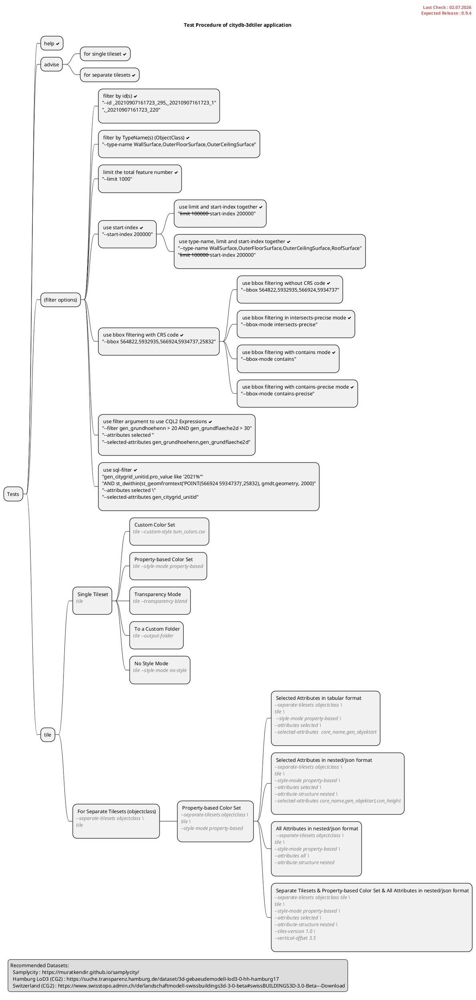

# Test Procedures

## Test Procedures Diagram

This diagram shows the list of test procedures to be carried out in order to perform an internal quality check or to prevent function loss during developments.

## Previous Tests

The following list contains the links of the previous tests carried out by following the test procedures.
Test procedures are usually handled before publishing a new release.

- Before release 0.9.3
    - [Tests done with Swisstopo dataset](https://www.3dcitydb.net/3dcitydb/fileadmin/public/kendir/#bern_full_procedure){:target="_blank"}
- Before release 0.9.2
    - [Tests done for SamplyCity Dataset](https://www.3dcitydb.net/3dcitydb/fileadmin/public/kendir/#test_campaign_03_samplycity){:target="_blank"}
- Test with Hamburg LoD3 dataset
    - [Hamburg Buildings LoD3](https://www.3dcitydb.net/3dcitydb/fileadmin/public/kendir/#test_campaign_02_hamburg){:target="_blank"}
- Test with Melbourne dataset
    - [Melbourne Buildings & Roads](https://www.3dcitydb.net/3dcitydb/fileadmin/public/kendir/#tests_for_3dtiler_melbourne){:target="_blank"}

