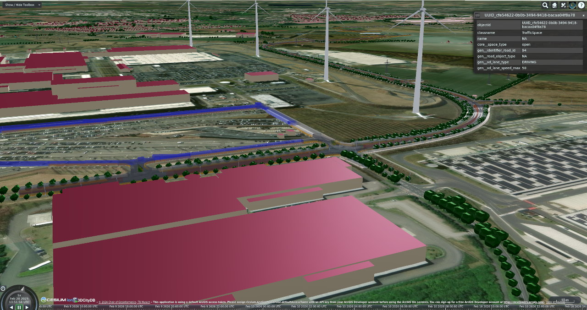

`citydb-3dtiler` turns the city objects stored in a 3DCityDB `v5` into [3D Tiles](https://www.ogc.org/standards/3dtiles/){target="blank"},
ready to be streamed to web viewers such as [CesiumJS](https://cesium.com/platform/cesiumjs/){target="blank"} or the
3DCityDB-Web-Map-Client. One command reads the features from the database, colors them, and writes the tileset.

/// figure-caption
3D Tiles of Leipzig generated with `citydb-3dtiler`.
///

!!! warning "Testing phase"
    `citydb-3dtiler` is still being tested. Use it with care in production, and please share your feedback on
    [GitHub](https://github.com/3dcitydb/citydb-3dtiler/issues){target="blank"}.

## What it can do

- Create 3D Tiles `1.1` or `1.0` from any data in a 3DCityDB `v5`
- Color features by object class or by attribute value, using a simple CSV file
- Embed feature attributes so they can be queried in the viewer
- Tile only parts of your data, filtered by type, area, ID, CQL2 or SQL
- Run in Docker without installing anything else

## Where to go from here

- :material-school:{ .lg .middle } __Tutorial__

    ---

    New to `citydb-3dtiler`? Create and view your first 3D Tiles from a sample dataset in about 15 minutes.

    [:octicons-arrow-right-24: Your first 3D Tiles](tutorial.md)

- :material-hammer-wrench:{ .lg .middle } __How-to guides__

    ---

    Step-by-step recipes for common tasks: filtering, coloring, attributes, output settings.

    [:octicons-arrow-right-24: How-to guides](how-to/install.md)

- :material-book-open-variant:{ .lg .middle } __Reference__

    ---

    All command-line options, the materials CSV format, the advice file and the Docker image.

    [:octicons-arrow-right-24: CLI reference](reference/cli.md)

- :material-lightbulb-on:{ .lg .middle } __Explanation__

    ---

    How `citydb-3dtiler` works under the hood: tiling, styling rules and attribute names.

    [:octicons-arrow-right-24: How it works](explanation.md)

## Acknowledgements

`citydb-3dtiler` is developed by the [Chair of Geoinformatics](https://www.asg.ed.tum.de/en/gis/){target="blank"} at the
Technical University of Munich (TUM). Its source code is available on
[GitHub](https://github.com/3dcitydb/citydb-3dtiler){target="blank"}. It builds on the [3DCityDB `v5`](../3dcitydb/index.md)
and on [pg2b3dm](https://github.com/Geodan/pg2b3dm){target="blank"}. Many thanks to Bert Temme, the developer of
pg2b3dm, and to all 3DCityDB developers.
