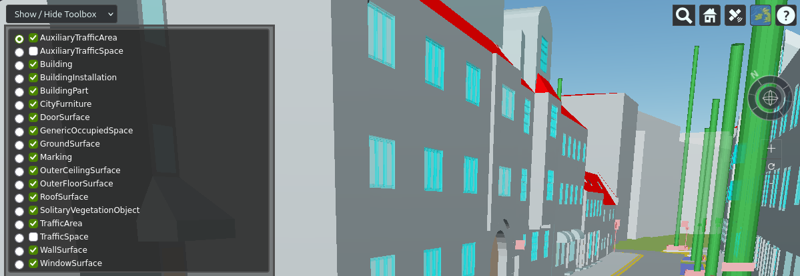

# Main Options

??? tip "Check all the subcommands and the options in one diagram"
    If you want to see all the subcommands and the options with possible arguments in one diagram, visit this page : [citydb-3dtiler Functionality Matrix](includes/functionality_matrix.md){:target="_blank"}

### --tiler-app

If the file name of the tiler application is different, you can use this option. 

- Default value is "pg2b3dm".

??? info "What is planned for this option?"
    We plan to enable the use of the i3dmExport and/or py3dtiles applications with this option in future developments. However, currently only the pg2b3dm application has been tested and is ready for use.

### --tilers-path

If you want to use a specific version of pg2b3dm that you have determined, you must put this specific version into another folder and then specify the folder path using this option. This way, you can make the application work with any version you want.

- Default value is "tiler_app".

??? Warning "Some (tile) options might not work in this scenario"
    Since the options of the pg2b3dm application may vary depending on the version, you may not be able to use every argument.

### --separate-tilesets

This option is used to specify the criteria for creating multiple tilesets. You can create separate tilesets by considering the objectclasses (Building, Wall, Window etc.) or namespaces (bldg, tun, brid etc.) of the features.

- Default value is "objectclass"

[A Sample 3D Scene contains separate tilesets](https://tinyurl.com/schwabingolstadt2026){:target="_blank"}

