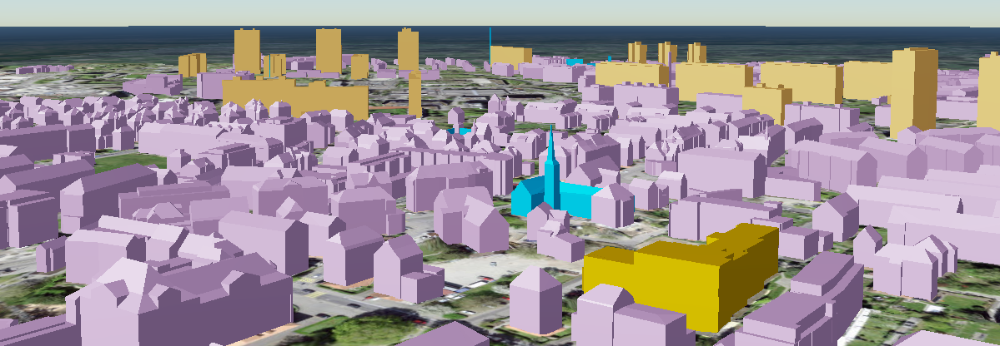

# tile Command

With the `tile` command, features in the database are converted to the 3DTiles format. The generated tilesets are saved under the `shared` folder in the directory where the program is executed. If the `--separate-tilesets` option is used, a separate folder is created within the `shared` folder for each tileset according to the separation argument (namespace or objectlass name), and the 3DTiles files are stored into these folders.

## --help (-h)

If you use the help option after the `tile` command, you will see the usage syntax of that command which is like below.

```bash
tile [-h] \
    [--style-mode {existing-appearances,property-based,objectclass-based,no-style}] \
    [--style-absence-behavior {fall-down,rise-up}] \
    [-o [Output Folder]] \
    [--transparency {blend,mask,opaque}] \
    [--custom-style [Name of the custom style file]] \
    [-a {none,selected,all}] \
    [--selected-attributes [Comma separated list of the selected attributes]] \
    [--attribute-structure {flat,nested}] \
    [--tiles-version {1.0,1.1}] \
    [--vertical-offset [VERTICAL_OFFSET]]
```

## --style-mode

Style mode is used to assign material styles to features. Customizing PBR materials using the given CSV file is not the only option. There are four different style modes, and there is a mechanism (called `style-absence-behaviour`) that switches to another mode in case a style mode cannot be applied to a feature. The four style modes are like below:

- `existing-appearances` :
    - When this option is selected, tiling application will try to derive the defined appearences in the database (not the textures yet, but only the materials).
- `property-based` :
    - If you decided to assign colors to the features by considering some attributes, you can fill the relevant columns in `materials_for_features.csv` file and then select this option.
- `objectlass-based` (default value) : 
    - This mode is the default value for this option and it simply assigns the defined materials for every individual objectlass by considering the relevant columns in `materials_for_features.csv` file.
- `no-style` : 
    - In this option, there will be no different material for the features. Every feature will be rendered within the color specified in the `materials_for_features.csv` file in the column `pbr_metallic_roughness_base_color` for the pseudo-feature called `anything-else`.

- Example : `--style-mode existing-appearances`

[An example Scene for the property-based styling option](https://tinyurl.com/testsBern2026){:target="_blank"}



## --style-absence-behaviour

This option can be switched when a special absence behaviour is requested. The default behaviour is `fall-down`. This means that, for example, if the user selected the `property-based` style mode but the application could not find any value for the specified property, it will try to assign material according to the style mode at the next lower level; in this case, that mode will be `objectclass-based`. Only one of the following arguments expected : 

- `fall-down` (default value)
- `rise-up`

??? tip "What is the order of the style modes?"
    The vertical order of the style modes is exactly the same as their order in the help documents. The first mode is at the top, and the last mode is at the bottom. Therefore, the vertical order should be accepted from top to bottom as follows: existing-appearances, property-based, objectclass-based, no-style.

## --output-folder

Generated tilesets are stored directly in the shared folder. However, you can specify a folder name in which the tilesets will be stored.

## --transparency

This is the option that determines the transparency of materials. Default value is `opaque`. Only one of the following arguments expected : 

- `blend` : 
    - When set to this, the last two digits of the color codes in the CSV file (the RGBA code) will determine the amount of transparency.
- `mask` :
    - When the masking option is selected, object textures are not rendered when they fall below a certain alpha value (this option has not been tested yet).
- `opaque` (default value):
    - When set to opaque, any transparency value assigned to materials in the CSV file will be ignored even if present.

- Example : `--transparency-mode blend`

## --custom-style

If you want to provide a custom style file (any CSV file not named `materials_for_features`), you can specify the file name (inc. file extension : `.csv`) using this argument.

- Example : `--custom-style materials_for_traffic_areas.csv`

## --attributes (-a)

Available attributes can be ignored, filtered out, or selected as a whole. These attributes can be queried in the CesiumJS environment (they cannot be queried in QGIS for now) or used for interactive styling via additional JavaScript code. To specify which option fits your workflow, you can select one of the following options:

- `none` (default value)
- `selected` (use the `--selected attributes` option together)
- `all` 

- Example : `--attributes all`

## --selected-attributes

Selected attributes must be listed with their exact names as they appear in the advice.yml file. The list separator is a comma, and no space characters should be used.

- Example : `--attributes selected --selected-attributes core_name,con_height,gen_citygrid_unitid`

??? tip "Where can i find the exact names of the attributes?"
    Check the `advice.yml` file to see the exact names of the available attributes.

## --attribute-structure

If you want to view the attributes as a flat/tabular data structure, select the “flat” option (default). If you want to view them as a nested structure, just as they are (in a JSON-like stucture), select the “nested” option. 

- `flat` (default value)
- `nested`

??? "Are the JSON-like nested attributes visible on CesiumJS?"
    Yes, they are visible on CesiumJS. However, if you want to display them in a foldable / unfoldable tree-like widget, you need to write additional JavaScript code. Otherwise, they would appear just like ordinary JSON text.

## --tiles-version

3D Tilesets can be generated in two versions : 1.0 and 1.1. If you are curious about the differences between these versions, we would highly recommend to visit the standard's OGC documentation page. 

- `1.0`
- `1.1`

- Example : `--tiles-version 1.0`

[A video shows the usage of the 3DTiles v1.0 on QGIS Desktop](https://www.3dcitydb.net/3dcitydb/fileadmin/public/kendir/bern_full_procedure/video/sample_3dtiles_on_qgis_desktop_f_resit_rey_cmp.mkv){:target="_blank"}

??? tip "How can i show the 3DTiles on QGIS Desktop app?"
    There are multiple methods to visualize the 3DTiles on the QGIS Desktop (using CesiumIon plugin etc.). If you just want to visualize the 3DTiles on QGIS Desktop without using any cloud storage, then you need to generate the 3DTiles in the version 1.0. Store the tileset into your computer within version 1.0, then simply locate the tileset.json file in QGIS Desktop.

## --vertical-offset

Specify the vertical offset as a float number (for exp. 0.15 / -1.25) in meter unit. Do not use comma as decimal separator. 

- Example : `--vertical-offset 0.15` | `--vertical-offset -0.55`

