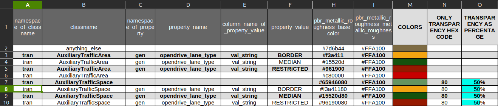
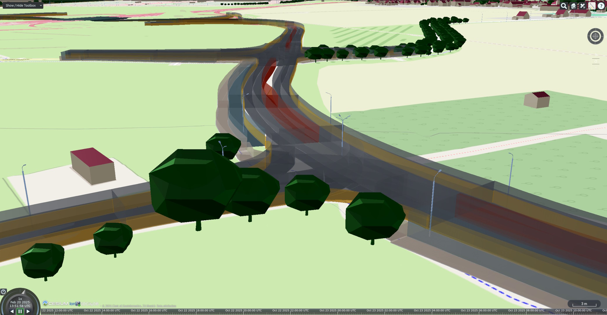

The `tile` command generates 3D Tiles from the features stored in a 3DCityDB `v5`. It selects the features based on the
[filter options](filter.md), assigns materials and attributes, and calls the 3D Tiles generator to write one or more
tilesets to the output folder.

## Synopsis

```bash
citydb-3dtiler [OPTIONS] tile [TILE OPTIONS]
```

## Options

The `tile` command uses all global options of the main [`citydb-3dtiler`](cli.md#options) command, including the
[database connection](database.md) and [filter](filter.md) options. These global options must be specified *before*
the command. Additionally, it defines the following options.

### General tile options

| Option                                | Description                                                                                  | Default value |
|---------------------------------------|----------------------------------------------------------------------------------------------|---------------|
| `-h`, `--help`                        | Show a help message and exit.                                                                |               |
| `-o`, `--output-folder=<folder>`      | Name of the folder to write the 3D Tiles to, relative to the working directory.              | `shared`      |
| `--tiles-version=<version>`           | 3D Tiles version: `1.0`, `1.1`.                                                              | `1.1`         |
| `--vertical-offset=<offset>`          | Vertical offset in meters to apply to all geometries, e.g. `0.15` or `-1.25`.                | `0.0`         |

### Styling options

| Option                                | Description                                                                                       | Default value               |
|---------------------------------------|---------------------------------------------------------------------------------------------------|-----------------------------|
| `--style-mode=<mode>`                 | Styling mode: `existing-appearances`, `property-based`, `objectclass-based`, `no-style`.          | `objectclass-based`         |
| `--style-absence-behavior=<behavior>` | Behavior if no material matches a feature: `fall-down`, `rise-up`.                                | `fall-down`                 |
| `--transparency=<mode>`               | Alpha mode for transparent materials: `blend`, `mask`, `opaque`.                                  | `opaque`                    |
| `--custom-style=<file>`               | Name of the CSV file with custom materials in the working directory.                              | `materials_for_features.csv` |

### Attribute options

| Option                                                  | Description                                                                                | Default value |
|---------------------------------------------------------|--------------------------------------------------------------------------------------------|---------------|
| `-a`, `--attributes=<mode>`                             | Attributes to include in the 3D Tiles: `none`, `selected`, `all`.                          | `none`        |
| <code>--selected-attributes=<name>[,<name>...]</code>   | Names of the attributes to include when using `--attributes selected`.                     |               |
| `--attribute-structure=<structure>`                     | Structure of the attributes: `flat`, `nested`.                                             | `flat`        |

## Usage

### Generating 3D Tiles

Without additional options, the `tile` command generates a single 3D Tiles `1.1` tileset of all features in the
database, styled by object class using the default materials.

```bash
python3 citydb-3dtiler.py \
  --db-host my.host.de --db-port 5432 \
  --db-name citydb --db-schema citydb \
  --db-username postgres --db-password changeMe \
  tile
```

The `tile` command uses the recommended maximum number of features per tile from the `advice.yml` file in the working
directory. If this file does not exist, the [`advise`](advise.md) command is run automatically first. Use the
`--separate-tilesets` option of the main command to create [one tileset per object class](cli.md#separate-tilesets).

!!! note
    To prepare the tiling, `citydb-3dtiler` creates helper tables, views and a materialized view in the 3DCityDB
    schema. These objects are recreated on each run.

### Output folder

By default, the tilesets are written directly to the working directory (the `shared` folder when using
[Docker](docker.md)). Use the `--output-folder` option to write them to a subfolder instead. The folder is created
automatically if it does not exist. With separate tilesets, each tileset is written to its own subfolder named after
the object class.

```bash
tile --output-folder leipzig_tiles
```

### 3D Tiles version

The `--tiles-version` option sets the version of the generated 3D Tiles. Version `1.1` is the default and uses
[implicit tiling](https://docs.ogc.org/cs/22-025r4/22-025r4.html){target="blank"}. Choose version `1.0` if your
viewer does not support 3D Tiles `1.1` yet.

### Vertical offset

The `--vertical-offset` option moves all geometries up or down by the given number of meters. Use it to compensate for
height differences between the city model and the terrain of your viewer, for example when buildings appear to float
above or sink into the terrain.

```bash
tile --vertical-offset 0.5
```

### Styling

The `--style-mode` option determines how materials are assigned to the features:

- `existing-appearances`: Use the appearances stored with the features in the 3DCityDB. This mode is
  experimental.
- `property-based`: Assign materials based on the value of a feature property, as defined in the
  [materials file](#custom-materials).
- `objectclass-based`: Assign materials based on the object class of the feature, as defined in the
  [materials file](#custom-materials). This is the default mode.
- `no-style`: Use the default material for all features.

The styling modes are ordered from the most specific to the most generic, as listed above. If no material can be
assigned to a feature in the selected mode, the `--style-absence-behavior` option controls which mode is tried next:

- `fall-down`: Fall back to the next more *generic* mode. For example, with `property-based` styling, features
  without a matching property value are styled by their object class. This is the default behavior.
- `rise-up`: Try the next more *specific* modes instead. For example, with `objectclass-based` styling, features
  without a matching object class are styled by their property values or existing appearances.

!!! note
    The `rise-up` behavior cannot be combined with the `no-style` and `existing-appearances` modes.

### Custom materials

The materials used for styling are defined in a CSV file. `citydb-3dtiler` looks for a file named
`materials_for_features.csv` in the working directory. If no such file exists, the default materials shipped with the
tool are used. To use a CSV file with a different name, provide the file name with the `--custom-style` option.

The easiest way to create your own materials is to download the
[`materials_for_features.ods`](https://github.com/tum-gis/citydb-3dtiler/blob/main/materials_for_features/materials_for_features.ods){target="blank"}
spreadsheet, adapt the colors in the first sheet `materials` using LibreOffice, OpenOffice or OnlyOffice, and save
this sheet as CSV file.


/// figure-caption
Sample of the materials table with property-based and transparent materials.
///

!!! warning "CSV format"
    - Use commas (`,`) as field delimiter.
    - Do not quote the text values.
    - Keep the header row and the column order of the original file.

Each row of the CSV file defines a material for an object class, optionally restricted to a property value:

| Column                                       | Description                                                                                   |
|----------------------------------------------|-----------------------------------------------------------------------------------------------|
| `namespace_of_classname`                     | Namespace alias of the object class, e.g. `bldg`, `con`, `tran`.                              |
| `classname`                                  | Name of the object class, e.g. `Building` or `WallSurface`.                                   |
| `namespace_of_property`                      | Namespace alias of the property used for property-based styling, e.g. `gen`.                  |
| `property_name`                              | Name of the property used for property-based styling.                                         |
| `column_name_of_property_value`              | Column of the `PROPERTY` table that stores the value, e.g. `val_string` or `val_int`.         |
| `property_value`                             | Property value the material applies to.                                                       |
| `emmisive_color`                             | Emissive color as hex code.                                                                   |
| `pbr_metallic_roughness_base_color`          | Base color of the PBR metallic-roughness material as RGBA hex code, e.g. `#0065bdff`.         |
| `pbr_metallic_roughness_metallic_roughness`  | Metallic and roughness factors of the PBR material as hex code.                               |
| `pbr_specular_glossiness_diffuse_color`      | Diffuse color of the PBR specular-glossiness material as hex code.                            |
| `pbr_specular_glossiness_specular_glossiness`| Specular and glossiness factors of the PBR specular-glossiness material as hex code.          |

Rows without property columns are used for `objectclass-based` styling, rows with property columns for
`property-based` styling. The row with the class name `anything_else` defines the default material for features
without a matching entry.

```csv
namespace_of_classname,classname,namespace_of_property,property_name,column_name_of_property_value,property_value,emmisive_color,pbr_metallic_roughness_base_color,pbr_metallic_roughness_metallic_roughness,pbr_specular_glossiness_diffuse_color,pbr_specular_glossiness_specular_glossiness
,anything_else,,,,,,#ffff00ff,#000000,,
bldg,Building,,,,,,#0065bdff,#000000,,
bldg,Building,gen,OBJEKTART,val_string,Hochhaus,,#e37222ff,#000000,,
con,RoofSurface,,,,,,#e37222ff,#000000,,
con,WindowSurface,,,,,,#00ffff40,#000000,,
```

!!! tip
    The last two digits of an RGBA hex code define the opacity of the color, from `00` (fully transparent) to `ff`
    (fully opaque). The spreadsheet contains a macro (*View > Macros*) that previews the colors and transparency
    values in its third sheet `Colors`.

### Transparency

The `--transparency` option sets the alpha mode of the materials in the 3D Tiles. With the default `opaque` mode, the
alpha values of the colors are ignored. Use `blend` to render transparent materials, for example for windows, rooms or
traffic areas, and `mask` to render materials either fully transparent or fully opaque.

```bash
tile --transparency blend
```


/// figure-caption
Traffic areas and spaces rendered with transparent materials using `--transparency blend`.
///

### Attributes

By default, the 3D Tiles only contain the identifier and the object class of each feature. Use the `--attributes`
option to embed further feature attributes, which can then be queried in the viewer:

- `none`: Do not include additional attributes. This is the default.
- `selected`: Include the attributes listed with the `--selected-attributes` option. Provide the
  [attribute names](filter.md#attribute-names) as comma-separated list without spaces.
- `all`: Include all attributes available for the object classes.

The `--attribute-structure` option determines how the attributes are represented. The `flat` structure stores each
attribute as a separate column in a tabular form. The `nested` structure keeps complex attributes with their nested
values in a JSON-like structure.

```bash
tile --attributes selected --selected-attributes core_name,gen_objektart,con_height --attribute-structure nested
```


/// figure-caption
Feature attributes embedded in the 3D Tiles using the `nested` attribute structure.
///

!!! tip
    The attributes available for each object class are listed in the `advice.yml` file created by the
    [`advise`](advise.md) command.
