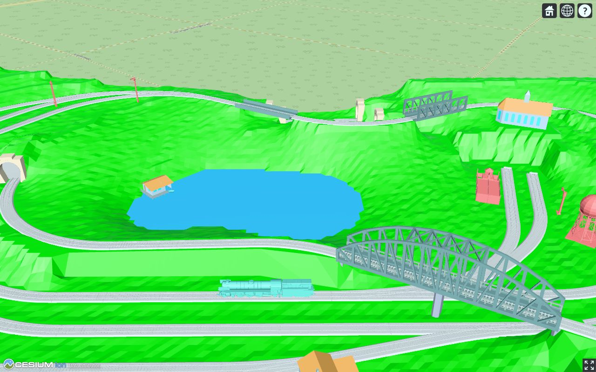

In this tutorial, you will set up a 3DCityDB, load a sample city model into it, turn it into 3D Tiles with
`citydb-3dtiler`, and look at the result in your web browser. Everything runs in Docker, so you do not need to install
anything else.


/// figure-caption
The 3D Tiles you will create in this tutorial, shown in CesiumJS.
///

__What you need__

- [Docker](../first-steps/docker.md#get-docker) installed and running
- An internet connection to download the Docker images and the sample data
- About 15 minutes

## Step 1: Prepare a working folder

Create an empty folder for this tutorial and open a terminal in it. All files of the tutorial are stored in this
folder.

=== "Linux"

    ```bash
    mkdir citydb-3dtiler-tutorial
    cd citydb-3dtiler-tutorial
    ```

=== "Windows CMD"

    ```bat
    mkdir citydb-3dtiler-tutorial
    cd citydb-3dtiler-tutorial
    ```

Download the [:material-download: Railway Scene LoD3](https://github.com/3dcitydb/importer-exporter/raw/master/resources/samples/Railway%20Scene/Railway_Scene_LoD3.zip)
sample dataset and save the file `Railway_Scene_LoD3.zip` in this folder. On Linux, you can also use `curl`:

```bash
curl -LO "https://github.com/3dcitydb/importer-exporter/raw/master/resources/samples/Railway%20Scene/Railway_Scene_LoD3.zip"
```

## Step 2: Start a 3DCityDB

First, create a Docker network. It lets the containers of this tutorial talk to each other by name.

```bash
docker network create citydb-net
```

Next, start a 3DCityDB container named `citydb`. The coordinate reference system (`SRID` and `SRS_NAME`) matches the
one of the sample dataset.

=== "Linux"

    ```bash
    docker run -d --name citydb \
      --network citydb-net \
      -e POSTGRES_PASSWORD=changeMe \
      -e SRID=3068 \
      -e SRS_NAME="urn:ogc:def:crs,crs:EPSG::3068,crs:EPSG::5783" \
    3dcitydb/3dcitydb-pg
    ```

=== "Windows CMD"

    ```bat
    docker run -d --name citydb ^
      --network citydb-net ^
      -e POSTGRES_PASSWORD=changeMe ^
      -e SRID=3068 ^
      -e SRS_NAME="urn:ogc:def:crs,crs:EPSG::3068,crs:EPSG::5783" ^
    3dcitydb/3dcitydb-pg
    ```

The database needs a few seconds to start. Run `docker logs citydb` and wait until you see the message
`database system is ready to accept connections`.

## Step 3: Import the sample data

Import the sample dataset into the 3DCityDB with [citydb-tool](../citydb-tool/index.md). The working folder is mounted
into the container as `/data`.

=== "Linux"

    ```bash
    docker run -i -t --rm --name citydb-tool \
      --network citydb-net \
      -v "$PWD:/data" \
    3dcitydb/citydb-tool import citygml \
      -H citydb -d postgres -u postgres -p changeMe \
      Railway_Scene_LoD3.zip
    ```

=== "Windows CMD"

    ```bat
    docker run -i -t --rm --name citydb-tool ^
      --network citydb-net ^
      -v "%cd%:/data" ^
    3dcitydb/citydb-tool import citygml ^
      -H citydb -d postgres -u postgres -p changeMe ^
      Railway_Scene_LoD3.zip
    ```

citydb-tool prints a summary of the imported features, such as bridges, buildings, railways and vegetation, and ends
with `citydb successfully completed`.

## Step 4: Analyze the data

Before creating tiles, let `citydb-3dtiler` take a look at the data with the `advise` command. Like citydb-tool, it
connects to the database container by its name `citydb`.

=== "Linux"

    ```bash
    docker run -i -t --rm --name citydb-3dtiler \
      --network citydb-net \
      -v "$PWD:/home/tester/citydb-3dtiler/shared" \
    tumgis/citydb-3dtiler \
      -H citydb -d postgres -u postgres -p changeMe \
      advise
    ```

=== "Windows CMD"

    ```bat
    docker run -i -t --rm --name citydb-3dtiler ^
      --network citydb-net ^
      -v "%cd%:/home/tester/citydb-3dtiler/shared" ^
    tumgis/citydb-3dtiler ^
      -H citydb -d postgres -u postgres -p changeMe ^
      advise
    ```

The command creates the file `advice.yml` in your working folder. Open it in a text editor. It lists all object
classes found in the database together with their attributes, and the recommended number of features per tile:

```yaml
max_features: 7
objectclasses:
-   name: Bridge
    properties:
    - brid_class
    - brid_function
    - core_appearance
    # ...
```

`citydb-3dtiler` uses this file in the next step to create well-balanced tiles.

## Step 5: Create the 3D Tiles

Now run the `tile` command. The `--output-folder` option writes the tiles to a subfolder named `tiles`.

=== "Linux"

    ```bash
    docker run -i -t --rm --name citydb-3dtiler \
      --network citydb-net \
      -v "$PWD:/home/tester/citydb-3dtiler/shared" \
    tumgis/citydb-3dtiler \
      -H citydb -d postgres -u postgres -p changeMe \
      tile --output-folder tiles
    ```

=== "Windows CMD"

    ```bat
    docker run -i -t --rm --name citydb-3dtiler ^
      --network citydb-net ^
      -v "%cd%:/home/tester/citydb-3dtiler/shared" ^
    tumgis/citydb-3dtiler ^
      -H citydb -d postgres -u postgres -p changeMe ^
      tile --output-folder tiles
    ```

After a few seconds, the `tiles` folder contains your 3D Tiles: the `tileset.json` file, which describes the tileset,
and the `content` and `subtrees` folders with the tile data.

!!! tip
    If you get a `Permission denied` error on Linux, see [here](how-to/troubleshooting.md#permission-denied-when-writing-files).

## Step 6: View the result

To view the tiles, you need a small web page and a web server. Create a file named `index.html` in the `tiles`
folder with the following content. It loads [CesiumJS](https://cesium.com/platform/cesiumjs/){target="blank"} and
displays the tileset on an OpenStreetMap background.

```html title="tiles/index.html"
<!DOCTYPE html>
<html>
<head>
  <meta charset="utf-8">
  <title>citydb-3dtiler viewer</title>
  <script src="https://cesium.com/downloads/cesiumjs/releases/1.121/Build/Cesium/Cesium.js"></script>
  <link href="https://cesium.com/downloads/cesiumjs/releases/1.121/Build/Cesium/Widgets/widgets.css" rel="stylesheet">
  <style>html, body, #viewer { width: 100%; height: 100%; margin: 0; }</style>
</head>
<body>
  <div id="viewer"></div>
  <script>
    const viewer = new Cesium.Viewer("viewer", {
      baseLayer: new Cesium.ImageryLayer(new Cesium.OpenStreetMapImageryProvider({
        url: "https://tile.openstreetmap.org/"
      })),
      baseLayerPicker: false,
      geocoder: false,
      timeline: false,
      animation: false,
      navigationInstructionsInitiallyVisible: false
    });
    Cesium.Cesium3DTileset.fromUrl("tileset.json").then((tileset) => {
      viewer.scene.primitives.add(tileset);
      viewer.zoomTo(tileset);
    });
  </script>
</body>
</html>
```

Start a web server for the `tiles` folder, again using Docker:

=== "Linux"

    ```bash
    docker run -d --name citydb-viewer -p 8080:80 \
      -v "$PWD/tiles:/usr/share/nginx/html:ro" \
    nginx
    ```

=== "Windows CMD"

    ```bat
    docker run -d --name citydb-viewer -p 8080:80 ^
      -v "%cd%\tiles:/usr/share/nginx/html:ro" ^
    nginx
    ```

!!! tip
    If Docker reports that port `8080` is already allocated, use another port, e.g. `-p 8081:80`, and adapt the URL
    below accordingly.

Open <http://localhost:8080> in your web browser. The viewer zooms to the railway scene, and you can explore the
model with your mouse: drag to rotate, scroll to zoom. The features are colored by their object class, using the
default colors of `citydb-3dtiler`.

## Step 7: Clean up

When you are done, remove the containers and the network:

```bash
docker rm -f -v citydb-viewer citydb
docker network rm citydb-net
```

## What's next?

Congratulations, you have created your first 3D Tiles with `citydb-3dtiler`! From here, you can:

- [Use your own colors](how-to/style.md) for the features
- [Add attributes](how-to/attributes.md) that can be queried in the viewer
- [Tile only part of your data](how-to/filter.md)
- Learn [how `citydb-3dtiler` works](explanation.md)
