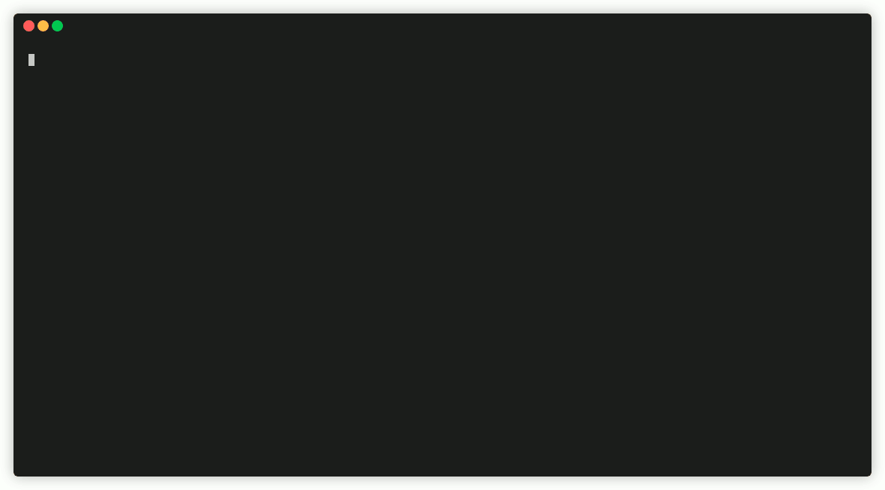

The quickest way to get up and running with 3DCityDB is using Docker!  On this page you will find quick start examples for the 3DCityDB and tools using Docker :material-docker:. Follow the examples to [create](#3dcitydb-docker) a database, [import CityGML](#import-citygml-data) data, and create an [export](#export-citygml-data) in minutes.

A much more detailed example on importing and exporting data using 3DCityDB and citydb-tool Docker including a test dataset can be found [here](../citydb-tool/docker.md#citydb-tool-docker-combined-with-3dcitydb-docker).

## TL;DR

- [3D City Database](../3dcitydb/docker.md): Create a 3DCityDB Docker container with `SRID=25832`.

    === "Linux"

        ``` bash
        docker pull 3dcitydb/3dcitydb-pg

        docker run -d -p 5432:5432 --name citydb \
          -e POSTGRES_PASSWORD=changeMe \
          -e SRID=25832 \
        3dcitydb/3dcitydb-pg
        ```

    === "Windows CMD"

        ``` bash
        docker pull 3dcitydb/3dcitydb-pg

        docker run -d -p 5432:5432 --name citydb ^
          -e POSTGRES_PASSWORD=changeMe ^
          -e SRID=25832 ^
        3dcitydb/3dcitydb-pg
        ```

- [citydb-tool](../citydb-tool/docker.md): Connect to the container specified above.

    === "Linux"

        ``` bash
        docker run -i -t --rm --name citydb-tool \
          --network host \
          -v /my/data/:/data \
          -e CITYDB_HOST=localhost \
          -e CITYDB_PORT=5432 \
          -e CITYDB_NAME=postgres \
          -e CITYDB_USERNAME=postgres \
          -e CITYDB_PASSWORD=changeMe \
        3dcitydb/citydb-tool [help|import|export|delete|index]
        ```

    === "Windows CMD"

        ``` bash
        docker run -i -t --rm --name citydb-tool ^
          --network host ^
          -v /my/data/:/data ^
          -e CITYDB_HOST=localhost ^
          -e CITYDB_PORT=5432 ^
          -e CITYDB_NAME=postgres ^
          -e CITYDB_USERNAME=postgres ^
          -e CITYDB_PASSWORD=changeMe ^
        3dcitydb/citydb-tool [help|import|export|delete|index]
        ```

    !!! tip

        Use the `help` command to list all CLI parameters and arguments. For subcommands (e.g. `import citygml`) us this syntax `import help citygml` to show CLI options.

## What is Docker?

[Docker :fontawesome-brands-docker:](https://docker.com){target="blank"} is a widely used virtualization technology that makes it possible to pack an application with all its required resources into a standardized unit—the _Docker Container_. Software encapsulated in this way can run on Linux, Windows, macOS, and most cloud services without any further changes or setup process. Docker containers are lightweight compared to traditional virtualization environments that emulate an entire operating system because they contain only the application and all the tools, program libraries, and files it requires.

Docker enables you to get a 3DCityDB instance up and running in a few seconds, without having to set up a database server or the 3DCityDB database schema, as shown below.


/// figure-caption
Setup a 3DCityDB instance using Docker and establish a connection to the ready-to-use 3DCityDB in seconds.
///

### Get Docker

To run the 3DCityDB images, you need to install _Docker Engine_. Installation instructions for Linux are available [here](https://docs.docker.com/desktop/setup/install/linux/){target="blank"}. For Windows, it is recommended to download and install [Docker Desktop](https://www.docker.com/products/docker-desktop/){target="blank"}.

## Docker images overview

Docker images are available for the following tools of the 3DCityDB software suite:

- [3D City Database](../3dcitydb/docker.md)
- [citydb-tool](../citydb-tool/index.md)
- [3DCityDB Importer/Exporter](https://3dcitydb-docs.readthedocs.io/en/latest/impexp/docker.html){target="blank"}
- [3D Web Map Client](https://3dcitydb-docs.readthedocs.io/en/latest/webmap/docker.html){target="blank"}
- [3DCityDB Web Feature Service (WFS)](https://3dcitydb-docs.readthedocs.io/en/latest/wfs/docker.html){target="blank"}

!!! warning "Docker image compatibility"

    3DCityDB `v5` introduces a substantially changed database schema, that requires a new set of tools.

    __Currently, only [citydb-tool](../citydb-tool/index.md) and [citydb-3dtiler](../citydb-3dtiler/index.md) are compatible with 3DCityDB `v5`__. Usage of legacy 3DCityDB `v4` tools such as the [Importer/Exporter](https://3dcitydb-docs.readthedocs.io/en/latest/impexp/docker.html) or the [Web Feature Service (WFS)](https://3dcitydb-docs.readthedocs.io/en/latest/wfs/docker.html){target="blank"} is still possible by migrating data to a 3DCityDB `v4`. See [here](../compatibility.md) for more details on compatibility of CityGML versions and 3DCityDB tools, and how to migrate data between versions.

### Get 3DCityDB Docker images

All images are available from [DockerHub]{target="blank"} or Github container registry ([ghcr.io]{target="blank"}). An overview of available versions and image variants is available [here](../3dcitydb/docker.md#image-variants-and-versions). Pull the `latest` image once to make sure you are using 3DCityDB `v5`, or use a `v5` tag.

- [3D City Database](../3dcitydb/docker.md)

    === "DockerHub"

        ``` bash
        docker pull 3dcitydb/3dcitydb-pg
        # or
        docker pull 3dcitydb/3dcitydb-pg:5
        ```

    === "Github container registry"

        ``` bash
        docker pull ghcr.io/3dcitydb/3dcitydb-pg
        # or
        docker pull ghcr.io/3dcitydb/3dcitydb-pg:5
        ```

!!! tip

    To benefit of the latest bugfixes and features of PostgreSQL/PostGIS spatial functions, we recommend to use the `alpine` image versions. See [here](../3dcitydb/docker.md#image-variants-and-versions) for more details on the differences between the `debian` and `alpine` image variants.

    === "DockerHub"

        ``` bash
        docker pull 3dcitydb/3dcitydb-pg:latest-alpine
        # or
        docker pull 3dcitydb/3dcitydb-pg:5-alpine
        ```

    === "Github container registry"

        ``` bash
        docker pull ghcr.io/3dcitydb/3dcitydb-pg:latest-alpine
        # or
        docker pull ghcr.io/3dcitydb/3dcitydb-pg:5-alpine
        ```

- [citydb-tool](../citydb-tool/docker.md)

    === "DockerHub"

        ``` bash
        docker pull 3dcitydb/citydb-tool
        ```

    === "Github container registry"

        ``` bash
        docker pull ghcr.io/3dcitydb/citydb-tool
        ```

## Quick start examples

The following sections provide _quick start_ code snippets for all 3DCityDB Docker images to get you running in a few seconds. For more comprehensive documentation, please visit the individual chapters of each image.

- [3DCityDB Docker](../3dcitydb/docker.md)
- [citydb-tool Docker](../citydb-tool/docker.md)

### 3DCityDB Docker

To run a PostgreSQL/PostGIS 3DCityDB container the only required settings are a database password (`POSTGRES_PASSWORD`) and the EPSG code of the coordinate reference system (`SRID`) of the 3DCityDB instance. Use the `docker run -p` switch to define a port to expose to the host system for database connections. The detailed documentation for the 3DCityDB Docker image is available [here](../3dcitydb/docker.md).

=== "Linux"

    ``` shell
    docker run -d -p 5432:5432 --name cdb \
      -e POSTGRES_PASSWORD=changeMe \
      -e SRID=25832 \
    3dcitydb/3dcitydb-pg
    ```

=== "Windows CMD"

    ``` shell
    docker run -d -p 5432:5432 --name cdb ^
      -e POSTGRES_PASSWORD=changeMe ^
      -e SRID=25832 ^
    3dcitydb/3dcitydb-pg
    ```

A container started with the command above will host a 3DCityDB instance configured like this:

``` text
CONTAINER NAME    cdb
DB HOST           localhost or 127.0.0.1
DB PORT           5432
DB NAME           postgres
DB USER           postgres
DB PASSWD         changeMe
DB SRID           25832
DB GMLSRSNAME     urn:ogc:def:crs:EPSG::25832
```

### citydb-tool Docker

The Docker image exposes the commands of the [`citydb-tool`](../citydb-tool/index.md). The environment variables listed below allow to specify a 3DCityDB `v5` connection. To exchange data for import or export with the container, mount a host folder to `/data` inside the container.

=== "Linux"

    ``` bash
    docker run --rm --name citydb-tool -i -t \
      --network host \
      -e CITYDB_HOST=localhost \
      -e CITYDB_NAME=postgres \
      -e CITYDB_USERNAME=postgres \
      -e CITYDB_PASSWORD=changeMe \
      -v /my/data/:/data \
    3dcitydb/citydb-tool COMMAND # (1)!
    ```

    1. The commands of `citydb-tool` are documented [here](../citydb-tool/index.md).

=== "Windows CMD"

    ``` bash
    docker run --rm --name citydb-tool -i -t ^
      --network host ^
      -e CITYDB_HOST=localhost ^
      -e CITYDB_NAME=postgres ^
      -e CITYDB_USERNAME=postgres ^
      -e CITYDB_PASSWORD=changeMe ^
      -v "c:\mydata:/data" ^
    3dcitydb/citydb-tool COMMAND # (1)!
    ```

    1. The commands of `citydb-tool` are documented [here](../citydb-tool/index.md).

#### Show help and CLI documentation

Use the `help` command to see the CLI documentation and list all available commands:

``` bash
docker run -i -t --rm 3dcitydb/citydb-tool help
```

Run `help COMMAND` to see the CLI documentation for a specific command:

``` bash
docker run -i -t --rm 3dcitydb/citydb-tool help import
docker run -i -t --rm 3dcitydb/citydb-tool help export
docker run -i -t --rm 3dcitydb/citydb-tool help delete
# ...
```

To see the usage description of a subcommand, use the `help` function of the top level command:

``` bash
docker run -i -t --rm 3dcitydb/citydb-tool import help citygml
```

#### Import CityGML data

Run the `import` command to import :material-database-import: a CityGML dataset located at `/local/data/dir/data.gml` (Linux) or
`c:\local\data\dir\data.gml` (Windows).

=== "Linux"

    ``` bash
    docker run -i -t --rm -u $(id -u):$(id -g) \
      --network host \
      -v /local/data/dir:/data/ \
      -e CITYDB_HOST=localhost \
      -e CITYDB_NAME=postgres \
      -e CITYDB_USERNAME=postgres \
      -e CITYDB_PASSWORD=changeMe \
    3dcitydb/citydb-tool import citygml "/data/data.gml"
    ```

=== "Windows CMD"

    ``` bash
    docker run -i -t --rm ^
      --network host ^
      -v "c:\local\data\dir:/data/" ^
      -e CITYDB_HOST=localhost ^
      -e CITYDB_NAME=postgres ^
      -e CITYDB_USERNAME=postgres ^
      -e CITYDB_PASSWORD=changeMe ^
    3dcitydb/citydb-tool import citygml "/data/data.gml"
    ```

#### Export CityGML data

Run the `export` command to export :material-database-export: a CityGML dataset to `/local/data/dir/export.gml` (Linux) or
`c:\local\data\dir\export.gml` (Windows).

=== "Linux"

    ``` bash
    docker run -i -t --rm -u $(id -u):$(id -g) \
      --network host \
      -v /local/data/dir:/data/ \
      -e CITYDB_HOST=localhost \
      -e CITYDB_NAME=postgres \
      -e CITYDB_USERNAME=postgres \
      -e CITYDB_PASSWORD=changeMe \
    3dcitydb/citydb-tool export citygml -o "/data/export.gml"
    ```

=== "Windows CMD"

    ``` bash
    docker run -i -t --rm ^
      --network host ^
      -v "c:\local\data\dir:/data/" ^
      -e CITYDB_HOST=localhost ^
      -e CITYDB_NAME=postgres ^
      -e CITYDB_USERNAME=postgres ^
      -e CITYDB_PASSWORD=changeMe ^
    3dcitydb/citydb-tool export citygml -o "/data/export.gml"
    ```

A much more detailed example on importing and export data using 3DCityDB and citydb-tool Docker can be found [here](../citydb-tool/docker.md#citydb-tool-docker-combined-with-3dcitydb-docker).

[Dockerhub]: https://hub.docker.com/u/3dcitydb
[ghcr.io]: https://github.com/orgs/3dcitydb/packages?ecosystem=container
